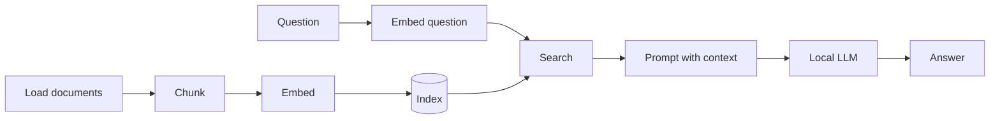

# RAG by Hand

A step-by-step course that builds a complete **Retrieval-Augmented Generation (RAG)** system
in Python, using **PyTorch** and **Hugging Face Transformers**, with no RAG framework in
between. Every step is written by hand, explained, and run on real documents, so you can see
what each part does and why it's there.

By the end, you can ask questions about your own documents and get answers from a small
language model running on your own computer, with the passages it used.


*The same 1.5B model on a laptop, asked about two documents it has never seen: first on its
own, then with the passages that retrieval found ([lesson 9](lessons/lesson09_rag.md)).*

<details>
<summary>The output as text</summary>

```
$ uv run lessons/lesson09_rag.py "How do I run OpenSim locally?"

Q: How do I run OpenSim locally?
  without RAG: To run OpenSim locally, you need to download the source code from its GitHub repository
               and compile it using CMake or Visual Studio. Then, start the OpenSim executable in your
               preferred IDE or command line interface. Ensure you have all necessary dependencies
               installed for building and running OpenSim.
  retrieved:
    [1] 0.735  OpenSim Architecture > 1. Directory Structure > 1.5 Not in the repository
    [2] 0.734  OpenSim Architecture
    [3] 0.710  OpenSim Architecture > 1. Directory Structure
    [4] 0.702  OpenSim Architecture > 1. Directory Structure
  with RAG:    To run OpenSim locally, serve the repo root with any static web server such as `python3 -m
               http.server 8080` and open it in a browser.

$ uv run lessons/lesson09_rag.py "Can I bring my car to Kestrel Island?"

Q: Can I bring my car to Kestrel Island?
  without RAG: Yes, you can bring your car to Kestrel Island for camping or other activities.
  retrieved:
    [1] 0.747  kestrel-island.txt
    [2] 0.711  kestrel-island.txt
    [3] 0.699  kestrel-island.txt
    [4] 0.696  kestrel-island.txt
  with RAG:    No, private cars are not allowed on Kestrel Island.
```

OpenSim is a static web app with no build step, and the fictional island doesn't allow
cars. Without retrieval, the model guesses; with it, it reads.
</details>



## Who this is for

- You know some programming. Python experience helps, but the lessons explain every Python
  feature they use, and a [Python primer](docs/python-primer.md) covers the basics.
- You don't need any machine-learning background. Tensors, tokens, embeddings and language
  models are introduced from the ground up.

## The lessons

Each lesson is a Markdown file with the explanation and a Python script you run yourself.
Lessons build on each other: later scripts import functions from earlier ones.

| # | Lesson | What you build |
|---|---|---|
| 0 | [Setup](lessons/lesson00_setup.md) | Python environment, PyTorch, GPU check |
| 1 | [Loading the documents](lessons/lesson01_load.md) | Read `.txt` and `.md` files |
| 2 | [Chunking](lessons/lesson02_chunk.md) | Split documents along their structure, and see why naive splitting breaks |
| 3 | [Tokens](lessons/lesson03_tokens.md) | See text the way a model sees it, and fix the chunker |
| 4 | [Tensors 101](lessons/lesson04_tensors.md) | The PyTorch operations needed for embedding and search |
| 5 | [Embedding by hand](lessons/lesson05_embed.md) | Turn text into vectors with a transformer model |
| 6 | [The index](lessons/lesson06_index.md) | Save and reload vectors, and detect when they're out of date |
| 7 | [Search](lessons/lesson07_search.md) | Find the chunks that match a question |
| 8 | [A local LLM, without RAG](lessons/lesson08_llm.md) | Run a small language model and watch it make things up |
| 9 | [RAG](lessons/lesson09_rag.md) | Combine search and LLM, and compare the answers |
| 10 | [Evaluation](lessons/lesson10_eval.md) | Measure retrieval and answers on a test set, and compare settings |
| 11 | Reranking *(coming soon)* | Re-score the search results with a cross-encoder |
| 12 | Packaging *(coming soon)* | Turn the lessons into a reusable package with a CLI |

## Quick start

1. Install [uv](https://docs.astral.sh/uv/getting-started/installation/), a fast Python
   package manager. It also installs the right Python version for you.
2. Get the code and install the dependencies:
   ```bash
   git clone https://github.com/ghtomcat/rag-by-hand.git
   cd rag-by-hand
   uv sync
   ```
3. Check that everything works:
   ```bash
   uv run lessons/lesson00_setup.py
   ```
4. Open [lesson 0](lessons/lesson00_setup.md) and start reading.

## Requirements

| | |
|---|---|
| **Python** | 3.12, installed automatically by `uv` (pinned in `.python-version`) |
| **Disk** | about 3.3 GB for the two models, downloaded on first use to `~/.cache/huggingface/` |
| **Memory** | 8 GB RAM minimum, 16 GB recommended |
| **GPU** | optional. Apple Silicon (MPS) and NVIDIA (CUDA) are used automatically. On CPU only, everything still works, but the language model in lessons 8–9 is slower |

All outputs shown in the lessons come from an Apple M2 with 16 GB RAM. Your numbers will
differ slightly with other hardware or library versions. The conclusions won't.

## The documents

The course uses two documents in [`data/`](data/), chosen to be as different as possible:

- **`architecture.md`**: the architecture document of
  **[OpenSim](https://github.com/ghtomcat/opensim)**, an open-source browser flight
  simulator. About 11,000 words of real technical documentation, with headings,
  tables, code blocks and lots of identifiers. It's what makes chunking hard.
- **`kestrel-island.txt`**: a visitor's guide to a **fictional** island, written with an
  LLM for this course. About 2,000 words of plain prose without any structure.

Neither was in the training data of the models used here, so when an answer is correct,
it should have come from retrieval. (Lesson 1 explains the caveats: a few facts in an
LLM-written text can be guessed, and lesson 10 checks for that.) You can add your own `.txt` and `.md` files to `data/` at any time.
The index is rebuilt automatically.

## Models

| Purpose | Model | Size | License |
|---|---|---|---|
| Embedding | [`BAAI/bge-small-en-v1.5`](https://huggingface.co/BAAI/bge-small-en-v1.5) | 33M parameters, ~130 MB | MIT |
| Generation | [`Qwen/Qwen2.5-1.5B-Instruct`](https://huggingface.co/Qwen/Qwen2.5-1.5B-Instruct) | 1.5B parameters, ~3.1 GB | Apache 2.0 |

Both are small enough to run on a laptop, and both can be swapped for other models by
changing one constant (`MODEL_NAME` in lesson 3, `LLM_NAME` in lesson 8).

## Project structure

```
README.md
lessons/            one .md (explanation) + one .py (code) per lesson
eval/               the test questions for lesson 10 (questions.jsonl)
data/               the source documents
assets/             the demo GIF and its VHS script (demo.tape)
index/              the search index, generated in lesson 6 (not in git)
docs/
  glossary.md       the terms used in the course
  python-primer.md  the Python features the lessons use
  troubleshooting.md
  going-further.md  libraries and techniques beyond this course
pyproject.toml      dependencies (uv.lock pins exact versions)
```

## More

- [Glossary](docs/glossary.md)
- [Python primer](docs/python-primer.md)
- [Troubleshooting](docs/troubleshooting.md)
- [Going further](docs/going-further.md)

## How this course was made

The idea, the direction and the decisions are mine: what the course covers, the order of the
lessons, using my own project's documentation as real-world data, adding a fictional sample to
show why structure matters, and which findings to keep in the text. The code, the lesson texts,
the fictional island guide and the demo were written with [Claude Code](https://claude.com/claude-code),
working step by step under my direction.

Every output, number and exercise solution in the lessons comes from actually running the
code; nothing was written from memory. Where a run showed something unexpected, such as a
prompt change making answers worse, that finding went into the lesson rather than being
smoothed over.

## Verification

Last verified on 2026-10-15 with Python 3.12.13, PyTorch 2.14.1 and Transformers 5.19.0 on
an Apple M2:

- **Reproducibility:** a fresh clone of this repository ran all lessons without errors and
  reproduced the outputs shown in the lessons, apart from timings, including every
  generated answer.
- **Facts:** statements about the outside world (model licenses, sizes and settings, library
  behaviour and names, links) were checked against primary sources: model cards,
  configuration files, library source code and official documentation. Six were corrected.
- **Not checked:** the conceptual explanations, such as how attention works, why the
  `[CLS]` token can represent a whole text, or how causal and bidirectional models differ.
  They are standard material, but simplified, and they were written by an LLM. **They
  should be reviewed by someone with a machine-learning background.**

Found an error, or something that's outdated? Please
[open an issue](https://github.com/ghtomcat/rag-by-hand/issues).

## License

- **Code** (`lessons/*.py`): [MIT](LICENSE)
- **Lesson texts and docs** (`lessons/*.md`, `docs/`, `README.md`) and
  **`data/kestrel-island.txt`**: [CC BY 4.0](https://creativecommons.org/licenses/by/4.0/)
- **`data/architecture.md`**: from [OpenSim](https://github.com/ghtomcat/opensim),
  [MIT](https://github.com/ghtomcat/opensim/blob/HEAD/LICENSE)
