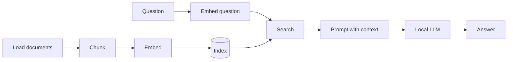

# RAG by Hand

A step-by-step course that builds a complete **Retrieval-Augmented Generation (RAG)** system
in Python, using **PyTorch** and **Hugging Face Transformers**, with no RAG framework in
between. Every step is written by hand, explained, and run on real documents, so you can see
what each part does and why it's there.

By the end, you can ask questions about your own documents and get answers from a small
language model running on your own computer, with the passages it used.



## Who this is for

- You know some programming. Python experience helps, but the lessons explain every Python
  feature they use, and a [Python primer](docs/python-primer.md) covers the basics.
- You don't need any machine-learning background. Tensors, tokens, embeddings and language
  models are introduced from the ground up.

## The lessons

Each lesson is a Markdown file with the explanation and a Python script you run yourself.
Lessons build on each other: later scripts import functions from earlier ones.

| # | Lesson | What you build |
|---|---|---|
| 0 | [Setup](lessons/lesson00_setup.md) | Python environment, PyTorch, GPU check |
| 1 | [Loading the documents](lessons/lesson01_load.md) | Read `.txt` and `.md` files |
| 2 | [Chunking](lessons/lesson02_chunk.md) | Split documents along their structure, and see why naive splitting breaks |
| 3 | [Tokens](lessons/lesson03_tokens.md) | See text the way a model sees it, and fix the chunker |
| 4 | [Tensors 101](lessons/lesson04_tensors.md) | The PyTorch operations needed for embedding and search |
| 5 | [Embedding by hand](lessons/lesson05_embed.md) | Turn text into vectors with a transformer model |
| 6 | [The index](lessons/lesson06_index.md) | Save and reload vectors, and detect when they're out of date |
| 7 | [Search](lessons/lesson07_search.md) | Find the chunks that match a question |
| 8 | [A local LLM, without RAG](lessons/lesson08_llm.md) | Run a small language model and watch it make things up |
| 9 | [RAG](lessons/lesson09_rag.md) | Combine search and LLM, and compare the answers |
| 10 | [Evaluation](lessons/lesson10_eval.md) | Measure retrieval and answers on a test set, and compare settings |
| 11 | Reranking *(coming soon)* | Re-score the search results with a cross-encoder |
| 12 | Packaging *(coming soon)* | Turn the lessons into a reusable package with a CLI |

## Quick start

1. Install [uv](https://docs.astral.sh/uv/getting-started/installation/), a fast Python
   package manager. It also installs the right Python version for you.
2. Get the code and install the dependencies:
   ```bash
   git clone https://github.com/ghtomcat/rag-by-hand.git
   cd rag-by-hand
   uv sync
   ```
3. Check that everything works:
   ```bash
   uv run lessons/lesson00_setup.py
   ```
4. Open [lesson 0](lessons/lesson00_setup.md) and start reading.

## Requirements

| | |
|---|---|
| **Python** | 3.12, installed automatically by `uv` (pinned in `.python-version`) |
| **Disk** | about 3.5 GB for the two models, downloaded on first use to `~/.cache/huggingface/` |
| **Memory** | 8 GB RAM minimum, 16 GB recommended |
| **GPU** | optional. Apple Silicon (MPS) and NVIDIA (CUDA) are used automatically. On CPU only, everything still works, but the language model in lessons 8–9 is slower |

All outputs shown in the lessons come from an Apple M2 with 16 GB RAM. Your numbers will
differ slightly with other hardware or library versions. The conclusions won't.

## The documents

The course uses two documents in [`data/`](data/), chosen to be as different as possible:

- **`architecture.md`**: the architecture document of
  **[OpenSim](https://github.com/ghtomcat/opensim)**, an open-source browser flight
  simulator. About 11,000 words of real technical documentation, with headings,
  tables, code blocks and lots of identifiers. It's what makes chunking hard.
- **`kestrel-island.txt`**: a visitor's guide to a **fictional** island, written for this
  course. About 2,000 words of plain prose without any structure.

Both describe things no language model has seen in training, so when an answer is correct,
it came from retrieval. You can add your own `.txt` and `.md` files to `data/` at any time.
The index is rebuilt automatically.

## Models

| Purpose | Model | Size | License |
|---|---|---|---|
| Embedding | [`BAAI/bge-small-en-v1.5`](https://huggingface.co/BAAI/bge-small-en-v1.5) | 33M parameters, ~130 MB | MIT |
| Generation | [`Qwen/Qwen2.5-1.5B-Instruct`](https://huggingface.co/Qwen/Qwen2.5-1.5B-Instruct) | 1.5B parameters, ~3.1 GB | Apache 2.0 |

Both are small enough to run on a laptop, and both can be swapped for other models by
changing one constant (`MODEL_NAME` in lesson 3, `LLM_NAME` in lesson 8).

## Project structure

```
README.md
lessons/            one .md (explanation) + one .py (code) per lesson
eval/questions.jsonl  the test questions for lesson 10
data/               the source documents
index/              the search index, generated in lesson 6 (not in git)
docs/
  glossary.md       the terms used in the course
  python-primer.md  the Python features the lessons use
  troubleshooting.md
  going-further.md  libraries and techniques beyond this course
pyproject.toml      dependencies (uv.lock pins exact versions)
```

## More

- [Glossary](docs/glossary.md)
- [Python primer](docs/python-primer.md)
- [Troubleshooting](docs/troubleshooting.md)
- [Going further](docs/going-further.md)

## License

- **Code** (`lessons/*.py`): [MIT](LICENSE)
- **Lesson texts and docs** (`lessons/*.md`, `docs/`, `README.md`) and
  **`data/kestrel-island.txt`**: [CC BY 4.0](https://creativecommons.org/licenses/by/4.0/)
- **`data/architecture.md`**: from [OpenSim](https://github.com/ghtomcat/opensim),
  [MIT](https://github.com/ghtomcat/opensim/blob/HEAD/LICENSE)
