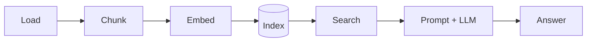

# Lesson 0: Setup

[Overview](../README.md) · [Lesson 1 →](lesson01_load.md)

> **You'll learn:** how the project is set up, what PyTorch and Hugging Face Transformers
> are for, and on which device your computer will run the models.
>
> **Run:** `uv run lessons/lesson00_setup.py`

## The plan

Over the next lessons you'll build this pipeline, one step per lesson:



- **Offline (indexing):** load documents, split them into chunks, turn each chunk into a
  vector, and store the vectors (lessons 1–6).
- **Online (questions):** turn a question into a vector, find the most similar chunks, and
  let a language model answer from them (lessons 7–9).

## The tools

- **[uv](https://docs.astral.sh/uv/)** manages Python itself and the project's packages.
  `pyproject.toml` lists the dependencies, `uv.lock` pins their exact versions, and
  `.python-version` pins Python 3.12. Packages are installed into a local `.venv/` folder,
  so nothing is installed system-wide.
- **[PyTorch](https://pytorch.org/)** (`torch`) does the math: tensors (multi-dimensional
  arrays of numbers) and fast operations on them, on the CPU or a GPU.
- **[Hugging Face Transformers](https://huggingface.co/docs/transformers)** (`transformers`)
  downloads pre-trained models from the Hugging Face Hub and runs them with PyTorch.

If you cloned this repository, `uv sync` has already installed everything. To create the
same setup in an empty folder yourself, you'd run:

```bash
uv init --python 3.12      # creates pyproject.toml, .python-version, a git repository,
                           # .gitignore, README.md and a placeholder main.py
uv add torch transformers  # installs both and records them in pyproject.toml and uv.lock
```

## The script

`lesson00_setup.py` prints the versions, picks the best device and runs one small
computation on it:

```python
def pick_device() -> str:
    # Prefer the Apple GPU ("mps"), then an NVIDIA GPU ("cuda"), else the CPU.
    if torch.backends.mps.is_available():
        return "mps"
    if torch.cuda.is_available():
        return "cuda"
    return "cpu"
```

Every PyTorch tensor lives on a **device**:

| Device | Hardware |
|---|---|
| `cpu` | the processor; always available, slowest for models |
| `cuda` | NVIDIA GPUs |
| `mps` | Apple Silicon GPUs (Metal Performance Shaders) |

All later lessons call `pick_device()`, so the same code runs on any of them.

## The output

```
Python:       3.12.13
PyTorch:      2.14.1
Transformers: 5.19.0
Device:       mps
Test matmul:  [[3.0], [7.0]] (computed on mps:0)
```

`a @ b` is a matrix multiplication: `[[1, 2], [3, 4]] @ [[1], [1]]` adds up each row, giving
`[[3], [7]]`. The `mps:0` shows it ran on the GPU. The same operation, at a much larger
scale, will be the search step in lesson 7.

## Python notes

- **`import torch`** loads a package. **`import sys`** loads a module from Python's
  standard library.
- **Indentation is syntax.** A block starts after `:` and lasts as long as the lines are
  indented.
- **`def pick_device() -> str:`** defines a function. `-> str` is a type hint: it documents
  the return type, but Python doesn't enforce it.
- **`f"Device: {device}"`** is an f-string: values in `{}` are inserted into the text.
- **`torch.tensor(..., device=device)`** passes an argument by name (a keyword argument).
- **`if __name__ == "__main__":`** runs `main()` only when the file is executed directly,
  not when another file imports it. Later lessons import functions from earlier ones, so
  every lesson has this guard.

More in the [Python primer](../docs/python-primer.md).

## Key takeaways

- `uv run <script>` runs a script with the project's Python and packages.
- PyTorch computes with tensors; Transformers provides the models.
- Every tensor lives on a device, and `pick_device()` chooses the fastest available one.

## Exercises

1. Run the script yourself: `uv run lessons/lesson00_setup.py`. Which device do you get?
2. Start an interactive Python session with `uv run python` and type:
   ```python
   import torch
   x = torch.tensor([1.0, 2.0, 3.0])
   x * 2
   x.shape
   ```
   Leave with `exit()`.

<details>
<summary>Solution 2</summary>

```
>>> x * 2
tensor([2., 4., 6.])
>>> x.shape
torch.Size([3])
```

`x * 2` multiplies every element. The shape `(3,)` means one dimension with three
elements. Lesson 4 covers shapes in detail.
</details>

---

[Overview](../README.md) · [Lesson 1: Loading the documents →](lesson01_load.md)
