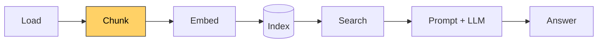
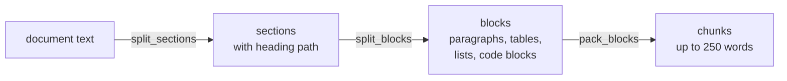

# Lesson 2: Chunking

[← Lesson 1](lesson01_load.md) · [Overview](../README.md) · [Lesson 3 →](lesson03_tokens.md)

> **You'll learn:** why documents are split into chunks, why the simplest way of splitting
> breaks structured documents, and how to build a chunker that follows the document's own
> structure.
>
> **Run:** `uv run lessons/lesson02_chunk.py`



## Concept

Retrieval doesn't return whole documents. It returns **pieces** (chunks), and the choice of
pieces is a trade-off:

- **Too big:** one vector has to represent many topics at once, so it matches none of them
  well. Big chunks also use up the language model's limited context.
- **Too small:** a piece loses its context. "It runs at 50 Hz", but what does?
- **Cut in the wrong place:** half a table or half a code block is often useless.

## Naive chunking, and what it breaks

The simplest chunker cuts the text into windows of a fixed number of characters, with some
overlap. Many tutorials start with it:

```python
def naive_chunks(text: str, size: int = 1500, overlap: int = 250) -> list[str]:
    step = size - overlap
    return [text[start:start + size] for start in range(0, len(text), step)]
```

The script compares it with the structure-aware chunker built in this lesson, on both
documents, and counts the chunks that break the document's structure:

```
architecture.md
                                 naive   structure-aware
  chunks                            64                91
  cut mid-word                      59                 1
  broken code block                 12                 0
  table rows without header         13                 0
  heading in the middle             49                 0

kestrel-island.txt
                                 naive   structure-aware
  chunks                            10                11
  cut mid-word                       9                 0
  broken code block                  0                 0
  table rows without header          0                 0
  heading in the middle              0                 0
```

- **The plain-text guide** only suffers one kind of damage: chunks start and end in the
  middle of a word or sentence. Splitting at paragraph boundaries is all it needs.
- **The technical document** breaks in every way: code blocks are cut open, table rows end
  up without their header row, and almost every chunk mixes two sections. Here's the start
  of one naive chunk:

  ```
  ▌js`, `core/catalog.js` |
  | `config/` | Cockpit configuration cascade. `defaults.json` is the base layer; ...
  | `panels/` | Layout specs for the data-driven glass displays ...
  ```

  It begins in the middle of a table cell, and nothing says what the columns mean or which
  section this is.

**The more structure a document has, the more a chunker has to understand it.** For the
prose guide, a simple approach is almost enough. For the architecture document, chunking
needs a real structure extractor.

## The structure-aware chunker

The rule: **cut where the author cut.** Headings already divide the document into topics,
so we follow them, and only split further when a section is too big.



**1. `split_sections`** walks through the lines and starts a new section at every heading.
It keeps a **heading path**, e.g. `OpenSim Architecture > 2. The Mission > 2.2 Load
lifecycle`, so every chunk knows where it belongs, even if its own text doesn't say.
Lines inside ```` ``` ```` code blocks are never treated as headings:

```python
for line in text.splitlines():
    if line.startswith("```"):
        in_code = not in_code
    match = None if in_code else HEADING_RE.match(line)
    if match:
        sections.append((path, lines))  # close the previous section
        level = len(match.group(1))     # "##" -> 2
        path = path[:level - 1] + [match.group(2).strip()]
        lines = []
    else:
        lines.append(line)
```

A plain-text file has no headings, so it becomes a single section, and its heading path is
just the file name.

**2. `split_blocks`** splits each section at blank lines. Tables and lists have no blank
lines inside them, so they automatically stay in one piece. Code blocks can contain blank
lines, so the function tracks whether it's inside one and never splits there. Horizontal
rules (`---`) are dropped.

**3. `pack_blocks`** fills chunks block by block until the next block would go over the
limit. Blocks are never cut in half. If the last block of a full chunk is short, it's
repeated at the start of the next chunk as **overlap**, so information at the boundary can
be found in both.

**4. `split_large_block`** handles the one exception: a single block that is bigger than the
limit on its own, like a long table or the directory tree in section 1. It's cut at line
boundaries, and:

- in a **code block**, the ```` ``` ```` fence lines are repeated in every part, so each part
  is a valid code block;
- in a **table**, the header row and the `|---|` line are repeated in every part, so each
  part still says what its columns mean.

The size of a text is measured by a function passed in as the `count` parameter. For now
it's `count_words`. Lesson 3 will show why that isn't good enough.

## The output

```
102 chunks  (max 250 words, overlap up to 50 words)
words per chunk: min 21, median 126, max 250

Size histogram:
     0-49   ████████████████████████ 24
    50-99   ███████████████████ 19
   100-149  ████████████████ 16
   150-199  ████████████████████ 20
   200-249  ██████████████████████ 22
   250-299  █ 1
```

The chunk for `2.2 Load lifecycle` is a good example: one chunk of 212 words, containing the
whole code block and the explanation that follows it.

Two things are worth a closer look:

**Small chunks.** The 5 smallest chunks are mostly introductions of `##` sections:

```
[architecture.md | OpenSim Architecture > 12. Input, Recording and External Links | 21 words]
The edges of the simulation: how input gets in, how flights are recorded, and how
the sim talks to other machines.
```

They aren't wrong, but they carry little information. They might help with broad questions
("What does section 12 cover?"). Lesson 10 will measure whether they help or hurt.

**The one "cut mid-word" chunk.** It comes from section 7.2, a bullet list longer than 250
words. `split_large_block` cut it at a line boundary, but the list items are wrapped across
several lines, so the cut falls in the middle of a sentence. Line boundaries aren't always
sentence boundaries.

**The plain-text chunks** have no heading path to give them context: every chunk of
`kestrel-island.txt` is labelled just `kestrel-island.txt`. That will matter in lesson 9.

## Python notes

- **`@dataclass class Chunk:`** declares a class from its typed fields; the constructor is
  generated automatically: `Chunk(source=..., heading_path=..., text=...)`.
- **`@property def words(self)`** defines a computed attribute, used as `chunk.words`
  without parentheses. `self` is the object the method belongs to.
- **`re.compile(r"^(#{1,6})\s+(.*)")`** compiles a regular expression. `r"..."` is a raw
  string, in which backslashes stay literal. `match.group(1)` returns the first captured
  group.
- **`tuple[list[str], list[str]]`** is a pair of two lists. `for path, lines in sections:`
  unpacks each pair into two variables.
- **`path[:level - 1] + [title]`** takes the first `level - 1` elements and appends the
  title.
- **`" > ".join(path) or doc["source"]`**: `or` returns the right side if the left side is
  empty, so files without headings use their file name.
- **`count=count_words`**: functions are values and can be passed as arguments.
- **`sorted(chunks, key=lambda c: c.words)`** sorts by a computed key; `lambda` defines a
  small anonymous function.
- **`next(x for x in items if ...)`** returns the first matching element.

## Key takeaways

- Fixed-size chunking works tolerably on plain prose, and breaks structured documents in
  many ways at once.
- Structure-aware chunking follows headings, paragraphs, tables and code blocks, and records
  each chunk's heading path.
- Every chunking rule has edge cases (tiny introductions, long lists). Look at the output
  before trusting it.

## Exercises

1. Change `MAX_WORDS` to `100` and run the script. How many chunks do you get? Then try
   `500`. Which setting do you expect to give better search results?
2. Section `4.1 Bundled data (built offline)` is split into several chunks. In `main()`,
   change the example from `2.2 Load lifecycle` to this section. Where are the cuts?
3. Set `OVERLAP_WORDS = 0`. What changes, and what could go wrong without overlap?
4. Find a naive chunk that cuts a code block open. (Hint: `text.count("```") % 2 == 1`.)

<details>
<summary>Solution 1</summary>

- `MAX_WORDS = 100`: 202 chunks.
- `MAX_WORDS = 250`: 102 chunks.
- `MAX_WORDS = 500`: 81 chunks, the largest 489 words. The number doesn't halve again,
  because most sections are shorter than 500 words anyway: the headings, not the limit,
  decide most cuts.

Which is better can't be decided by looking. Smaller chunks are more precise but lose
context; larger ones keep context but dilute the vector. Lesson 10 measures it.
</details>

<details>
<summary>Solution 2</summary>

Three chunks:

1. 38 words: the introduction ("Python scripts in `scripts/` download public data …").
2. 241 words: the large table of generated modules, starting with its header row.
3. 113 words: the paragraphs after the table.

The cuts fall exactly at block boundaries: the table didn't fit together with the
introduction, so it starts a new chunk.
</details>

<details>
<summary>Solution 3</summary>

Sections that are split across several chunks no longer share a paragraph at the boundary.
If a question's answer is in the paragraph at the end of one chunk, and the context needed
to understand it is at the start of the next one, neither chunk contains both. Overlap is
cheap insurance against that.
</details>

<details>
<summary>Solution 4</summary>

```python
from lesson01_load import load_documents
from lesson02_chunk import naive_chunks

md = load_documents()[0]["text"]
broken = [c for c in naive_chunks(md) if c.count("```") % 2 == 1]
print(len(broken))
print(broken[0][-300:])
```

12 naive chunks open a code block without closing it, or close one they didn't open.
</details>

---

[← Lesson 1: Loading](lesson01_load.md) · [Overview](../README.md) · [Lesson 3: Tokens →](lesson03_tokens.md)
