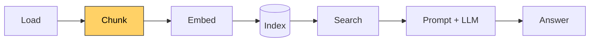

# Lesson 3: Tokens

[← Lesson 2](lesson02_chunk.md) · [Overview](../README.md) · [Lesson 4 →](lesson04_tensors.md)

> **You'll learn:** how a model reads text as tokens, why technical text costs far more
> tokens than prose, and how this silently breaks the chunker from lesson 2, and how to
> fix it.
>
> **Run:** `uv run lessons/lesson03_tokens.py`



## Concept

A model can't read text, only numbers. A **tokenizer** converts text into a list of
**token IDs** using a fixed **vocabulary**. Our embedding model, `BAAI/bge-small-en-v1.5`,
uses a WordPiece tokenizer with 30,522 vocabulary entries and reads **at most 512 tokens**.
Every model comes with its own tokenizer, and you always load the one that belongs to it:

```python
MODEL_NAME = "BAAI/bge-small-en-v1.5"
tokenizer = AutoTokenizer.from_pretrained(MODEL_NAME)  # downloads a few small files once
```

## 1. From text to tokens

```
text:   'The mission file decides which aircraft loads.'
tokens: ['[CLS]', 'the', 'mission', 'file', 'decides', 'which', 'aircraft', 'loads', '.', '[SEP]']
7 words -> 10 tokens
```

- **`[CLS]` and `[SEP]`** are special tokens added at the start and end of every text.
- **Everything is lowercase.** This model is *uncased*: `S` and `s` look identical to it.
- **Common words are one token each.** Plain English costs roughly 1.1–1.3 tokens per word.

```
text:   'Modules read `S.mission.*` directly via core/mission.js loadMission().'
tokens: ['[CLS]', 'modules', 'read', '`', 's', '.', 'mission', '.', '*', '`', 'directly', 'via',
         'core', '/', 'mission', '.', 'j', '##s', 'load', '##mission', '(', ')', '.', '[SEP]']
7 words -> 24 tokens
```

- **Code is expensive.** Each `.`, `/`, `` ` `` and `(` is a token of its own.
- **`##` marks a continuation** of the previous token. Words that aren't in the vocabulary
  are split into known pieces: `loadMission` → `load` + `##mission`, `Dryden` → `dry` +
  `##den`.

## 2. Batches, padding and the attention mask

```
input_ids:      [[101, 6718, 2091, 1012, 102,   0, 0, 0, 0, 0, 0],    ← "Gear down."
                 [101, 1996, 8285, ...                       , 102]]  ← a longer sentence
attention_mask: [[1, 1, 1, 1, 1, 0, 0, 0, 0, 0, 0],
                 [1, 1, 1, 1, 1, 1, 1, 1, 1, 1, 1]]
```

Texts in a batch are processed together as one rectangular tensor, so shorter texts are
filled up with **padding** (ID `0`, `[PAD]`). The **attention mask** marks which positions
are real tokens (`1`) and which are padding (`0`). Lessons 4 and 5 use it again.

## 3. Our chunks in tokens: the problem

```
102 chunks: min 27, median 236, max 872 tokens
total: 12,880 words -> 27,472 tokens

Lowest tokens per word (prose):
  1.14  kestrel-island.txt
Highest tokens per word (code, identifiers, tables):
  3.63  ... > 2. The Mission > 2.3 Field groups and their consumers
  3.88  ... > 3. The Aircraft (Vehicle) > 3.2 Field groups and their consumers
  4.44  ... > 1. Directory Structure > 1.3 `display/` — presentation

Chunks over the 512-token limit: 12
  845 tokens  ... > 2. The Mission > 2.3 Field groups and their consumers
  the model would stop reading here: '... ] ` | ` display / com. js `, ` core / crew. js ` ...'
  ...
```

The island guide costs about **1.1 tokens per word**. Tables full of field names cost
**3.6–4.4**. So lesson 2's limit of "250 words" really meant anything from under 300 to
almost 900 tokens, and **12 chunks are longer than the model can read.**

When a text is too long, the model only reads its first 512 tokens and **silently ignores
the rest**. In section 2.3, almost 40% of the table would be invisible to search. No error,
no warning at search time: just worse results. This is one of the most common silent bugs
in RAG systems.

Note that **all 12 chunks come from `architecture.md`**. The plain-text guide has no
problem at all. Again, the structured document is the hard one.

Two smaller findings:

- **`[UNK]`** (unknown token) appears where the directory tree uses box-drawing characters
  like `├` and `│`, which aren't in the vocabulary. Harmless here; they're decoration.
- The warning **"Token indices sequence length is longer than the specified maximum
  sequence length"** at the start is the tokenizer pointing at exactly this problem.

## 4. The fix: measure chunks in tokens

Lesson 2's `pack_blocks` and `split_large_block` take the counting function as a parameter.
So the fix doesn't change the chunking logic at all; it only passes a different function:

```python
MAX_TOKENS = 400
OVERLAP_TOKENS = 100

def make_token_counter(tokenizer):
    """Return a function that counts the tokens of a text (without [CLS]/[SEP])."""
    def count_tokens(text: str) -> int:
        return len(tokenizer(text, add_special_tokens=False)["input_ids"])
    return count_tokens

def chunk_documents_by_tokens(documents, tokenizer):
    return chunk_documents(documents, MAX_TOKENS, OVERLAP_TOKENS, make_token_counter(tokenizer))
```

The limit is **400**, not 512, to leave room for the heading path that lesson 5 adds before
each chunk, plus `[CLS]` and `[SEP]`.

```
                          before (words)  after (tokens)
chunks                               102             119
min tokens                            25              11
median tokens                        234             241
max tokens                           870             397
over 512 (with CLS/SEP)               12               0
```

No chunk is over the limit any more. Tables that were too big are now split into parts,
each starting with the repeated header:

```
--- 362 tokens
| Group | Fields | Consumer |
|---|---|---|
| **Environment** | `weather {source: live|manual, icao, manual, fallback}`, `timeOfDay`, ...
```

**From now on, all lessons use `chunk_documents_by_tokens`.**

## A new edge case: lead-in sentences

The smallest chunk is now only 11 tokens:

```
1.3 `display/` — presentation:  'Everything that draws. Three kinds of files live here:'
```

The sentence introduces the table that follows (note the colon). But the table part is
almost 400 tokens, so the two don't fit together, and the sentence ends up alone: a chunk
that is useless for search. Every chunking fix reveals the next edge case. Possible fixes:
always attach a block ending in `:` to the next block, or merge very small chunks with a
neighbour. We'll leave it for now and measure in lesson 10 whether it matters. Fixing
things that only *look* wrong, without measuring, is a common trap.

## Python notes

- **`AutoTokenizer.from_pretrained(name)`** downloads the tokenizer from the Hugging Face
  Hub on first use and loads it from a local cache afterwards.
- **`tokenizer(text)["input_ids"]`**: calling the tokenizer returns a dict-like object;
  `return_tensors="pt"` makes it return PyTorch tensors instead of lists.
- **`make_token_counter`** returns a function defined inside it. The inner function keeps
  access to `tokenizer` (a **closure**).
- **`zip(counts, chunks)`** pairs up two lists element by element.
- **`rows[-3:]`**: negative indices count from the end; this is the last three elements.
- **`f"{x:.2f}"`** formats a number with two decimal places.

## Key takeaways

- Models count **tokens**, not words. Technical text can cost 3–4 times as many tokens per
  word as prose.
- Text beyond a model's limit is silently truncated, so chunk sizes must be measured with
  the model's own tokenizer.
- Passing the counting function as a parameter made the fix a one-line change.

## Exercises

1. Before reading section 4 of the script: how would you change lesson 2's chunker to
   count tokens? Try writing `count_tokens` yourself.
2. Set `MAX_TOKENS = 200`. How many chunks do you get, and is any chunk over 200 tokens?
   Why?
3. Tokenize a sentence of your own with identifiers or code, e.g. from your own project.
   How many tokens per word does it cost?

<details>
<summary>Solution 1</summary>

```python
def count_tokens(text: str) -> int:
    return len(tokenizer(text, add_special_tokens=False)["input_ids"])

chunks = chunk_documents(documents, max_size=400, overlap=100, count=count_tokens)
```

`add_special_tokens=False` leaves out `[CLS]` and `[SEP]`: they're added once when a
chunk is embedded, not for every block that is counted.
</details>

<details>
<summary>Solution 2</summary>

212 chunks, and the largest has 238 tokens, so it's over the limit. `split_large_block`
can only cut at line boundaries, and some single lines (long table rows) are longer than
200 tokens on their own. Splitting inside a line would need another rule, e.g. at sentence
boundaries. Every limit needs a decision about what to do with pieces that can't be cut.
</details>

<details>
<summary>Solution 3</summary>

```python
from transformers import AutoTokenizer
tokenizer = AutoTokenizer.from_pretrained("BAAI/bge-small-en-v1.5")
ids = tokenizer("your sentence here")["input_ids"]
print(len(ids), tokenizer.convert_ids_to_tokens(ids))
```

Expect 1.1–1.3 tokens per word for prose and 2–4 for code-heavy text.
</details>

---

[← Lesson 2: Chunking](lesson02_chunk.md) · [Overview](../README.md) · [Lesson 4: Tensors 101 →](lesson04_tensors.md)
