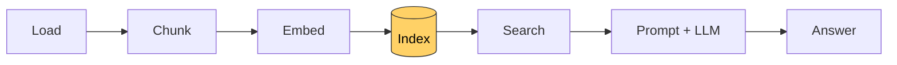

# Lesson 6: The index

[← Lesson 5](lesson05_embed.md) · [Overview](../README.md) · [Lesson 7 →](lesson07_search.md)

> **You'll learn:** how to save chunks and their vectors to disk, reload them instead of
> recomputing them, and detect when the saved index is out of date.
>
> **Run:** `uv run lessons/lesson06_index.py` (run it twice)



## Concept

Embedding is the expensive part of a RAG system. Chunks only change when the documents
change, but questions arrive all the time. So the work is split:

- **Indexing (offline):** chunk and embed **once**, then save the result.
- **Querying (online):** load the index, embed only the **question** (one short text), and
  search.

For our two documents the saving is small, but it grows with the corpus: 100,000 chunks
take minutes to hours to embed, and with a paid embedding API, every rebuild costs money.

## What gets saved

| File | Contents | Format |
|---|---|---|
| `index/vectors.pt` | the `(119, 384)` tensor | PyTorch's binary format |
| `index/chunks.json` | fingerprint, model, pooling, and every chunk's `source`, `heading_path` and `text` | JSON, human-readable |

The two files are linked **by position**: `chunks[i]` belongs to `vectors[i]`. If they ever
get out of step, every search result shows the wrong text, and nothing crashes. The script
checks it with an `assert`.

The `index/` folder is listed in `.gitignore`: it's generated output and can always be
rebuilt.

## The fingerprint

An outdated index is dangerous: search would return text that is no longer in the
documents. So the script computes a **fingerprint**, a hash of everything the index depends
on:

```python
def fingerprint(documents: list[dict]) -> str:
    h = hashlib.sha256()
    h.update(f"{MODEL_NAME}|{POOLING}|{MAX_TOKENS}|{OVERLAP_TOKENS}".encode())
    for doc in documents:
        h.update(doc["source"].encode())
        h.update(doc["text"].encode())
    return h.hexdigest()[:16]
```

If a single character in a document changes, or a setting, the fingerprint changes, and the
index is rebuilt:

```python
def load_or_build_index(embedder=None, verbose=True):
    documents = load_documents()
    fp = fingerprint(documents)
    saved = load_index()
    if saved is not None and saved[0] == fp:
        return saved[1], saved[2]           # up to date: no model needed
    embedder = embedder or Embedder(pooling=POOLING)
    chunks, vectors = build_index(documents, embedder)
    save_index(chunks, vectors, fp)
    return chunks, vectors
```

If the index is up to date, the embedding model isn't even loaded.

**One limitation:** changes to the chunking **code** aren't part of the fingerprint. After
changing the chunker, delete `index/` by hand. Real systems often add a version number to
the settings for this.

## The output

First run:

```
building index: no saved index
took 3.05 s

Files:
  index/chunks.json  109 KB
  index/vectors.pt  180 KB

119 chunks, vectors of shape (119, 384)
chunk 42 ('OpenSim Architecture > 5. Cockpit Panel Specs')
  saved vector == freshly computed vector: True
```

Second run:

```
index is up to date (fingerprint c3895af7c0ce80c1), loaded from index/
took 0.00 s
```

The sanity check re-embeds chunk 42 and compares it with the saved vector: saving and
loading lose nothing.

## Python notes

- **`"text".encode()`** turns a string into bytes (UTF-8), which hashing needs.
- **`hashlib.sha256()`**, **`.update(...)`**, **`.hexdigest()`** compute a hash piece by
  piece.
- **`json.dump(obj, f, indent=2, ensure_ascii=False)`** writes JSON to a file, readable,
  with characters like `—` kept as they are. **`json.load(f)`** reads it back.
- **`asdict(chunk)`** turns a dataclass into a dict; **`Chunk(**fields)`** turns a dict back
  into a dataclass.
- **`assert condition, "message"`** stops the program immediately if the condition is false.
- **`index_dir.mkdir(exist_ok=True)`** creates a folder, without an error if it exists.
- **`torch.load(path, weights_only=True)`** loads only plain tensors. `.pt` files can contain
  arbitrary Python objects, and loading those can run code, a real risk with files from
  untrusted sources.

## Key takeaways

- Index once, query many times.
- Chunks and vectors are linked by position; keep them in step.
- A fingerprint of sources and settings detects an outdated index automatically.

## Exercises

1. Open `index/chunks.json` in an editor and find a table that was split into parts. Can you
   see the repeated header row?
2. Add a sentence to the end of `data/kestrel-island.txt` and run the script. Then remove
   the sentence and run it again. Is the old fingerprint back?
3. In the REPL (in `lessons/`), find the two chunks that are most similar to each other:
   ```python
   import torch
   from lesson06_index import load_or_build_index
   chunks, vectors = load_or_build_index()
   sims = vectors @ vectors.T
   sims.fill_diagonal_(-1)      # ignore each chunk's similarity with itself
   ```

<details>
<summary>Solution 1</summary>

Search the file for `"heading_path": "OpenSim Architecture > 2. The Mission > 2.3 Field
groups and their consumers"`. It appears three times; the second and third chunks start
with `| Group | Fields | Consumer |\n|---|---|---|`.
</details>

<details>
<summary>Solution 2</summary>

The first run prints `building index: sources or settings changed (c3895af7… -> …)`. After
removing the sentence, the fingerprint is `c3895af7c0ce80c1` again, because it depends only
on the content, but the index is rebuilt a second time: only the most recent index is
kept.
</details>

<details>
<summary>Solution 3</summary>

```python
i = int(sims.argmax())
a, b = divmod(i, sims.shape[0])
print(sims[a, b].item(), chunks[a].heading_path, "|", chunks[b].heading_path)
```

The most similar pair (0.923) is a part of the directory tree in `1. Directory Structure`
and the table in `1.1 Data directories`. Both describe the same folders, once as a tree and
once as a table.
</details>

---

[← Lesson 5: Embedding by hand](lesson05_embed.md) · [Overview](../README.md) · [Lesson 7: Search →](lesson07_search.md)
