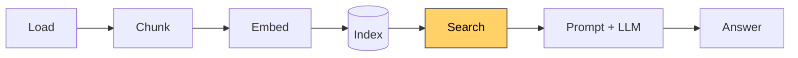

# Lesson 7: Search

[← Lesson 6](lesson06_index.md) · [Overview](../README.md) · [Lesson 8 →](lesson08_llm.md)

> **You'll learn:** how to find the chunks that match a question, how to read the results,
> and where similarity search goes wrong.
>
> **Run:** `uv run lessons/lesson07_search.py` (example questions), or
> `uv run lessons/lesson07_search.py "your question"`



## Concept: search is one matrix multiplication

```
question ──► embed (with the query instruction) ──► q        shape (384,)
scores = vectors @ q                                          (119, 384) @ (384,) → (119,)
torch.topk(scores, k=5)                                       the 5 best scores and their positions
```

This is lesson 4, section 6, at full size. Because all vectors are normalized, each score is
the cosine similarity between the question and one chunk.

```python
def search(query, chunks, vectors, embedder, k=5, instruction=True):
    text = QUERY_INSTRUCTION + query if instruction else query
    q = embedder.embed([text])[0]
    scores = vectors @ q
    top = torch.topk(scores, k=min(k, len(chunks)))
    return [(score, chunks[i]) for score, i in zip(top.values.tolist(), top.indices.tolist())]
```

Comparing the question with every chunk is called **exact** (or brute-force) search. With
119 chunks it takes well under a millisecond. Libraries like FAISS only become worthwhile
with hundreds of thousands of chunks, where they use **approximate** search to avoid
comparing against everything.

**The query instruction.** BGE models were trained with the prefix `"Represent this
sentence for searching relevant passages: "` in front of **questions**, but not in front of
documents. Questions and answers are phrased differently ("How do I…?" vs. "Serve the repo
root with…"), and the prefix tells the model which side it's looking at.

## The example questions

Each example has a snippet of text that the chunk holding the answer must contain, so the
script can check where the right chunk ranks:

```python
EXAMPLES = [
    ("How do I run OpenSim locally?", "python3 -m http.server"),
    ("What happens during step 5 of mission loading?", "2.2 Load lifecycle"),
    ...
    ("Who is the author of OpenSim?", None),     # the documents don't say
    ("When does the first ferry leave Port Alda on a Sunday?", "there is no morning sailing"),
    ...
]
```

## The results

**A clear hit:**

```
Q: What are the crash conditions?
  1. 0.790  … > 7.5 Crash conditions                 | Condition | Threshold |
  2. 0.643  … > 9. Aircraft Systems > 9.1 Overview    | Module | Applies to | …
```

The right section is first, far ahead of the next result. The question uses the section's
own words.

**Correct, but narrowly:**

```
Q: What happens during step 5 of mission loading?
  1. 0.709  … > 2.2 Load lifecycle
  2. 0.693  … > 2.1 Two files per mission
  3. 0.687  … > 6.4 Test stepping
```

The model matches "mission loading" with "Load lifecycle", but it doesn't understand "step
5". Embeddings capture topics, not numbering. In lesson 9, the language model has to find
step 5 inside the chunk.

**Nearly a tie, and the wrong chunk wins:**

```
Q: How do I run OpenSim locally?
  1. 0.735  … > 1.5 Not in the repository   Gitignored and created locally: `node_modules/` …
  2. 0.734  OpenSim Architecture            This document describes OpenSim … (contains the server command)
```

Section 1.5 contains the word "locally", but it's about git-ignored files. The actual answer
is in the introduction, 0.001 behind. Similar wording can beat the real answer.

**A misleading neighbour:**

```
Q: Does OpenSim support multiplayer?
  1. 0.710  OpenSim Architecture            … An optional Node WebSocket hub … connects multiple browsers …
  2. 0.681  … > 12.3 Hub and hardware-in-the-loop
```

The introduction comes first, and it *sounds* like multiplayer works: "connects multiple
browsers". The precise answer is in 12.3: "**Multi-crew isn't wired up.** … no state is
shared between two browsers." A chunk that is roughly related can rank above the one that
answers the question, and lesson 9 shows how that misleads the language model.

**The plain-text guide:**

```
Q: When does the first ferry leave Port Alda on a Sunday?
  1. 0.642  kestrel-island.txt   The lighthouse on Gannet Head, the northernmost point of the island, w…
  2. 0.636  kestrel-island.txt   The ferry does not sail when the wind is stronger than force 7 on the …
```

The first chunk is correct, but it starts with the lighthouse: without headings, chunks are
filled with several consecutive paragraphs, whatever their topic. Here, the lighthouse
paragraph and the ferry timetable share a chunk. And the results list doesn't tell you what
each chunk is about: they're all labelled `kestrel-island.txt`.

### Where the expected answer ranks

```
  question                                                     with  without  instruction
  How do I run OpenSim locally?                                   2        3
  What happens during step 5 of mission loading?                  1        1
  Which file decides which aircraft loads, the catalog or th      1        1
  What are the crash conditions?                                  1        1
  Does OpenSim support multiplayer?                               2        2
  Who is the author of OpenSim?                              (no answer in the documents)
  When does the first ferry leave Port Alda on a Sunday?          1        2
  Can I bring my car to Kestrel Island?                           1        1
  When can visitors climb the lighthouse?                         1        1
```

The answer is in the top 2 for every question, and the instruction helps in two cases. With
8 questions, that's an indication, not proof. Lesson 10 tests it properly.

## Three things to notice

1. **Scores are close together.** Nearly all results score between 0.6 and 0.8. As in
   lesson 5, the order counts, not the value. This also makes "the documents don't contain
   the answer" hard to detect from scores alone.
2. **Some chunks show up everywhere.** The introduction and the parts of the directory tree
   appear for many OpenSim questions. They mention almost every part of the system briefly,
   so they're a little similar to every question. This is called **hubness**.
3. **Exact terms are hard.** Identifiers and numbers ("step 5") carry little weight in an
   embedding. Combining embedding search with keyword search helps (see
   [going further](../docs/going-further.md)).

## Python notes

- **`sys.argv`** is the list of command-line arguments; `sys.argv[0]` is the script name.
- **`enumerate(results, start=1)`** yields a counter and each element; `_` is the
  conventional name for a value you don't use.
- **`ranks[0] or '-'`** shows `-` when the rank is `None`.
- **`f"{text:55}"`** pads a value to 55 characters.
- **`min(k, len(chunks))`**: `topk` fails if `k` is larger than the number of chunks.

## Key takeaways

- Search is `vectors @ q` followed by `topk`.
- A high score means "similar wording or topic", not "contains the answer".
- Look at the ranked results, not just the top one: the right chunk is often second.

## Exercises

1. Ask three or four questions of your own about either document. Is the right chunk at the
   top?
2. Ask something the documents don't cover, e.g. "Which license does OpenSim use?" or "How
   do I bake bread?". What scores do the results get? Could a score threshold say "not
   found"?
3. Ask the same question in two ways, one with the document's words and one without:
   "What are the crash conditions?" vs. "When does the plane get destroyed?". How do the
   scores change?

<details>
<summary>Solution 2</summary>

- "Which license does OpenSim use?": top score **0.706** (the introduction).
- "How do I bake bread?": top score **0.521** (a chunk about flight plans).

The bread question scores clearly lower. But the licence question, which the documents
don't answer either, scores **higher** than the Sunday ferry question (0.642), which they
do answer. A fixed threshold would either reject real answers or accept non-answers. Lesson
9 handles this differently: the language model decides whether the retrieved text
contains the answer.
</details>

<details>
<summary>Solution 3</summary>

"What are the crash conditions?" finds 7.5 with **0.790**; "When does the plane get
destroyed?" still finds 7.5 first, but with **0.637**, and the next results are only 0.03
behind. The model understands that "destroyed plane" relates to crashes, but the
match is much less certain without the shared words.
</details>

---

[← Lesson 6: The index](lesson06_index.md) · [Overview](../README.md) · [Lesson 8: A local LLM →](lesson08_llm.md)
