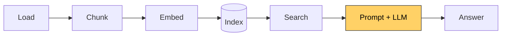

# Lesson 8: A local LLM, without RAG

[← Lesson 7](lesson07_search.md) · [Overview](../README.md) · [Lesson 9 →](lesson09_rag.md)

> **You'll learn:** how a language model generates text one token at a time, why
> instruction-tuned models need a chat template, and what a model answers about things it
> has never seen.
>
> **Run:** `uv run lessons/lesson08_llm.py` (the first run downloads about 3.1 GB)



## Concept: one token at a time

A language model does one thing: given the text so far, it computes a **probability for
every token in its vocabulary**, picks one, appends it, and repeats. A whole answer is this
loop, run many times.

We use `Qwen/Qwen2.5-1.5B-Instruct`: 1.54 billion parameters, small enough for a laptop,
and **instruction-tuned**, meaning it was trained to follow instructions in a chat format.

```
Qwen/Qwen2.5-1.5B-Instruct on mps, loaded in 7 s
1.54B parameters, torch.float16, ~3.1 GB in memory, vocabulary of 151,665 tokens
```

**float16** stores each parameter in 2 bytes instead of 4, halving the memory. On a CPU,
the script uses float32 instead, because float16 is slow or unsupported there.

## 1. Next-token prediction, by hand

```python
logits = generator.model(input_ids=ids).logits[0, -1]   # a score for every vocabulary entry
probs = torch.softmax(logits.float(), dim=0)            # scores → probabilities (sum to 1)
top = torch.topk(probs, k=3)
ids = torch.cat([ids, top.indices[:1].unsqueeze(0)], dim=1)   # append the winner, repeat
```

`[0, -1]` takes the first text and the **last position**: only the prediction after the last
token matters.

```
start: 'The capital of Switzerland is'
  ' __' 21%   ' Geneva' 6%   ' located' 6%
  '__\n' 73%  '________' 17%  '__.' 3%
  'A' 100%    'Which' 0%     'Please' 0%
  '.' 100%    ':' 0%         ')' 0%
  ' Bern' 27%  ' Geneva' 20%  ' Zurich' 13%
  '\n' 99%    ',' 0%         'a' 0%
result: 'The capital of Switzerland is ____\nA. Bern\n'
```

**The model didn't answer; it wrote a quiz.** Given raw text, it continues in the style it
has seen most often after such a sentence: fill-in-the-blank exercises with multiple-choice
answers. And even then, Bern gets only 27%, with Geneva at 20%. The model doesn't "know"
facts; it predicts what text would likely come next.

## 2. The chat template

An instruction-tuned model expects the format it was trained on:

```
<|im_start|>system
You are a helpful assistant. Answer concisely.<|im_end|>
<|im_start|>user
What does an altimeter measure?<|im_end|>
<|im_start|>assistant
```

A chat is still just text, with special tokens marking who is speaking. The prompt ends
with `assistant` and a line break: "your turn". Every model family has its own format, so
never build it by hand; the tokenizer applies it:

```python
inputs = tokenizer.apply_chat_template(messages, add_generation_prompt=True,
                                       return_dict=True, return_tensors="pt")
```

With the template, the model answers correctly from its training:

```
A: An altimeter measures altitude or height above mean sea level.
```

## 3. Generating an answer

```python
output = self.model.generate(**inputs, max_new_tokens=200, do_sample=False, ...)
new_tokens = output[0, inputs["input_ids"].shape[1]:]   # drop the prompt, keep the answer
```

- `generate` runs the loop from section 1 until the model emits its end token or reaches
  `max_new_tokens`.
- **`do_sample=False`** is **greedy decoding**: always the most likely token. Reproducible,
  and a good default for factual answers. With sampling (`temperature > 0`), each run gives
  a different answer.
- The output contains the prompt and the answer; slicing keeps only the answer.

## 4. Questions about our documents, without context

| Question | Model's answer | The documents say | |
|---|---|---|---|
| How do I run OpenSim locally? | "download the source code … and compile it using **CMake or Visual Studio**" | it's a static web app: `python3 -m http.server 8080` | ❌ wrong project |
| What happens during step 5 of mission loading? | "the player **selecting their character**, choosing their starting location …" | derive initial conditions: gear, brakes, engine state, altimeter | ❌ invented |
| Which file decides which aircraft loads? | "**The catalog file** decides …" | the **mission** file | ❌ confidently wrong |
| What are the crash conditions? | "I don't have specific information about 'crash conditions' …" | a table in §7.5 | ✅ honest |
| Does OpenSim support multiplayer? | "Yes, … through its **Multiplayer Server (MPS)** component." | multi-crew isn't wired up | ❌ invented |
| Who is the author of OpenSim? | "developed by the **SimGrid project team at INRIA**, France" | not mentioned | ❌ invented |
| First ferry on a Sunday? | "I don't have enough information …" | 12:15 from Port Alda | ✅ honest |
| Can I bring my car to Kestrel Island? | "**Yes**, you can bring your car … for camping" | private cars are not allowed | ❌ invented |
| When can visitors climb the lighthouse? | "cannot generally climb the lighthouse as it is typically closed to the public" | only on Lantern Night | ❌ plausible guess |

These are the typical ways a language model fails without retrieval:

- **Name collision:** other software called "OpenSim" exists, and the model answers about
  the one it knows.
- **Plausible invention:** the answers about step 5 or the car sound reasonable and are pure
  guesswork.
- **Confident errors:** "The catalog file decides" gives no hint of doubt.
- **Honest refusal**, twice: the behaviour we want whenever the model doesn't know. In
  lesson 9, we'll ask for it explicitly.

Speed on an Apple M2: 10–13 tokens per second, so a typical answer takes 2–5 seconds.

## Python and PyTorch notes

- **`AutoModelForCausalLM`** loads a model that predicts the next token. "Causal" means each
  token can only see the tokens before it. The embedding model (`AutoModel`, lesson 5)
  sees in both directions, because it only reads, it doesn't write.
- **`dtype=torch.float16`** chooses the number type the weights are loaded in.
- **`torch.softmax(x, dim=0)`** turns scores into probabilities; **`.float()`** converts to
  float32 first, for precision.
- **`f"{p:.0%}"`** formats 0.27 as `27%`.
- **`tuple[str, int]`** as a return type: `generate` returns the answer and its length;
  `answer, n_tokens = ...` unpacks both.

## Key takeaways

- A language model generates text by repeatedly predicting the next token.
- Instruction-tuned models need their chat template; build it with
  `apply_chat_template`.
- Asked about things it hasn't seen, a model often invents fluent, wrong answers.

## Exercises

1. In section 1, start from `"Q: What is the capital of Switzerland?\nA:"` instead. Does the
   model behave differently?
2. Ask a question about something only you know, e.g. your own project. How does the model
   invent its answer?
3. In `generate()`, set `do_sample=True, temperature=0.8` (and remove `temperature=None,
   top_p=None, top_k=None`), then ask "Does OpenSim support multiplayer?" three times.

<details>
<summary>Solution 1</summary>

```
start: 'Q: What is the capital of Switzerland?\nA:'
  ' Bern' 82%   ' Ber' 5%   ' Geneva' 5%
```

With a question-and-answer format, Bern gets **82%** instead of 27%. The model isn't more
knowledgeable; the text format makes an answer the most likely continuation. (After "Bern",
it continues with unrelated text: raw text has no end-of-answer marker. The chat template
provides one.)
</details>

<details>
<summary>Solution 3</summary>

Three runs gave, for example (yours will differ: that's the point of sampling):

- "Yes, OpenSim supports multiplayer simulations for up to 256 users simultaneously."
- "Yes, OpenSim supports multiplayer simulations."
- "Yes, OpenSim supports multiplayer."

With sampling, the details change from run to run (one even invents a user limit), while
the confident "yes" stays. Variation between runs is one hint that the model is guessing.
</details>

---

[← Lesson 7: Search](lesson07_search.md) · [Overview](../README.md) · [Lesson 9: RAG →](lesson09_rag.md)
