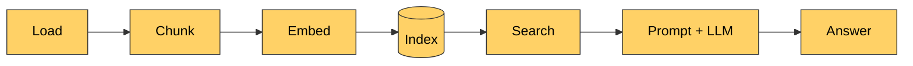

# Lesson 9: RAG

[← Lesson 8](lesson08_llm.md) · [Overview](../README.md) · [Lesson 10 →](lesson10_eval.md)

> **You'll learn:** how retrieval and generation fit together, how to write the prompt and
> why its wording matters, how to compare answers with and without RAG, and how to tell
> whether a bad answer is a retrieval or a generation problem.
>
> **Run:** `uv run lessons/lesson09_rag.py` (example questions, with and without RAG), or
> `uv run lessons/lesson09_rag.py "your question"` (one question, with and without RAG)



## Concept: RAG in three lines

```python
results = search(question, ...)              # lesson 7: the 4 best chunks
prompt  = build_prompt(question, results)    # put them into the prompt as numbered passages
answer  = ask(generator, prompt, system=RAG_SYSTEM_PROMPT)   # lesson 8: the model answers
```

The model doesn't change at all. It just gets **the relevant text in front of the
question**, and the instruction to answer **only from that text**. The model no longer has
to *remember* the facts, only *read* them.

## The prompt

```
--- system ---
You answer questions about the user's documents.
Use only the numbered context passages in the user's message, never outside knowledge.
Answer the question directly, in one to three sentences of your own words. Don't copy passages.
Cite the passages you used, like [1] or [2].
If the passages don't contain the answer, reply exactly: "The documentation doesn't say."
Be concise.
--- user ---
Context:

[1] (architecture.md › OpenSim Architecture > 2. The Mission > 2.1 Two files per mission)
| File | Role | Read by |
...
The catalog is presentation only. The mission file is the source of truth: ...

[2] (architecture.md › OpenSim Architecture > 3. The Aircraft (Vehicle))
...

Question: Which file decides which aircraft loads, the catalog or the mission file?
```

- **System message:** fixed rules. The most important one is the way out: "The
  documentation doesn't say."
- **User message:** numbered passages with their source and heading path, then the
  question last, right before the model starts answering.
- **Size:** 700–1,550 tokens per prompt. Qwen2.5 reads up to 32k tokens, so there's plenty
  of room.

```python
def build_prompt(question: str, results: list[tuple[float, Chunk]]) -> str:
    passages = []
    for n, (_, chunk) in enumerate(results, start=1):
        passages.append(f"[{n}] ({chunk.source} › {chunk.heading_path})\n{chunk.text}")
    context = "\n\n".join(passages)
    return f"Context:\n\n{context}\n\nQuestion: {question}"
```

The **`RAG` class** loads the index, the embedding model and the language model once, so
each question only costs a search and a generation: 3–7 seconds on an Apple M2.

## Without vs. with RAG

| Question | Without RAG | With RAG | |
|---|---|---|---|
| How do I run OpenSim locally? | "compile it using CMake or Visual Studio" | "serve the repo root with any static web server such as `python3 -m http.server 8080` and open it in a browser." | ❌ → ✅ |
| Step 5 of mission loading? | "the player selecting their character…" | "derives initial conditions … such as whether the aircraft is on the ground or airborne, and sets appropriate parameters like speed, altitude, and engine status accordingly." | ❌ → ⚠️ |
| Which file decides which aircraft loads? | "The catalog file" | "The mission file decides which aircraft loads, as its 'aircraft' field overrides the catalog's 'aircraft'." | ❌ → ✅ |
| Crash conditions? | "I don't have specific information" | "Hard landings trigger when the vertical speed drops below −800 fpm at the moment of touchdown. Overspeed occurs if an aircraft's speed exceeds `envelope.maxSpd` multiplied by 1.15. Terrain crashes happen when …altitude falls below `S.terrainElevFt`." | ✅ → ✅ |
| Multiplayer? | "Yes, through its Multiplayer Server (MPS)" | "No, OpenSim supports multi-player through its WebSocket hub in `server/` which allows multiple browsers or hardware to connect …" | ❌ → ❌ |
| Who is the author of OpenSim? | "the SimGrid project team at INRIA, France" | "The documentation does not specify who authored OpenSim." | ❌ → ✅ |
| First ferry on a Sunday? | "I don't have enough information" | "The first ferry of the day leaves Port Alda at 12:15 on Sundays." | ✅ → ✅ |
| Can I bring my car? | "Yes, … for camping or other activities" | "No, private cars are not allowed on Kestrel Island." | ❌ → ✅ |
| When can visitors climb the lighthouse? | "typically closed to the public" | "Visitors may climb the 127 steps to the top of the tower after the procession on Lantern Night." | ❌ → ✅ |

Seven of nine answers are now right. Without RAG, there were two honest refusals and seven
wrong or invented answers.

**The author question** is a special test: the documents don't say, so the right answer is
to refuse. Without RAG, the model invented a team and an institution. With RAG, it refuses.
(Not with the exact sentence the prompt asked for, but the meaning is right.) A question
**without** an answer in the documents tests whether the model stays within the context
instead of filling the gap.

## What still goes wrong

**1. Multiplayer: retrieved, and still wrong.** Section 12.3 says "Multi-crew isn't wired
up … no state is shared between two browsers." The model answers "No, OpenSim supports
multi-player through its WebSocket hub", which contradicts itself, and the second half is
wrong. The introduction, retrieved first, says "an optional Node WebSocket hub …
connects multiple browsers", and the model followed it. A passage that is *roughly*
related can pull the answer in the wrong direction.

**2. Step 5 is vague.** Retrieval was right (`2.2 Load lifecycle` came first), but the
model summarized instead of listing: no gear down, no park brake, no altimeter setting.
The crash answer also drops a detail: terrain only counts where it's more than 100 ft
above the field.

**3. No citations.** The prompt asks for `[1]`, `[2]`, but the model never cites. A 1.5B
model doesn't follow every instruction. The script lists the retrieved passages itself, so
you can still see the sources.

**4. The plain-text passages have no labels.** Every passage from the island guide shows
up as `kestrel-island.txt`, so the model gets no hint what each passage is about. The
answers were still right here, because the guide is short and clear. With larger
unstructured documents, missing structure makes both retrieval and answers worse.

## Prompt wording matters

The system prompt went through three versions while this lesson was written, with the same
retrieved passages each time:

| Version | What changed | Effect |
|---|---|---|
| A | "You answer questions about a software project called OpenSim." | Good answers, but wrong for the island guide and for your own documents. |
| B | Generic: removed the project name, nothing else. | **Worse:** for two island questions, the model copied whole passages instead of answering, once the wrong passage. |
| C (final) | Generic, plus "Answer the question directly, in one to three sentences of your own words. Don't copy passages." | Good answers for both documents. |

One sentence in the prompt made the difference between answering and copying. Small models
are especially sensitive to wording, so **test every prompt change on a fixed set of
questions**, not just one. That's what lesson 10 is about.

"Your own words" has a cost, too: paraphrasing can distort facts. In one test run, "above
`envelope.maxSpd` × 1.15" became "exceeds its maximum speed by more than 115%", which
is wrong. Numbers and identifiers are safest when copied exactly.

## Debugging: retrieval or generation?

When an answer is bad, **look at the retrieved passages first**:

- **The right passage is missing:** it's a retrieval problem. Work on chunking, embedding or
  search (lessons 2–7).
- **The right passage is there, and the answer is still wrong:** it's a generation problem.
  Work on the prompt or use a larger model.

Step 5 is a generation problem. Multiplayer is both: the right passage was retrieved, but a
misleading one ranked above it.

## Python notes

- **`"""…"""`** is a multi-line string, used for the system prompt.
- **`class RAG:`** groups the parts of the pipeline and loads the models once in
  `__init__`.
- **`tuple[str, list[tuple[float, Chunk]], str]`**: `answer()` returns the answer, the
  retrieved results and the prompt, so the caller can show all three.

## Key takeaways

- RAG puts retrieved text into the prompt and tells the model to answer only from it.
- A clear way out ("The documentation doesn't say.") turns hallucinations into honest
  refusals.
- Prompt wording changes answers a lot; test changes on many questions.
- Debug bad answers by checking the retrieved passages first.

## Exercises

1. Ask a question that the documents answer only indirectly, e.g. "Can I connect real
   hardware to OpenSim?". Is the answer right?
2. Change `TOP_K = 4` to `1`, ask "Does OpenSim support multiplayer?", then try `8`. Does
   more context make the answer better?
3. Add an example of a cited answer to the end of the system prompt, e.g.
   `Example: "The mission file decides [1]."`. Does the model cite now?
4. Remove the sentence "Answer the question directly, … Don't copy passages." from the
   system prompt and ask "When can visitors climb the lighthouse?". What happens?

<details>
<summary>Solution 1</summary>

"Yes, you can connect real hardware to OpenSim through the `server/robot_bridge.js` script
which acts as a bridge between the hub and the SO-101 arm's ESP32."

Correct and specific: section 12.3 was retrieved (third), and the model found the right
details in it.
</details>

<details>
<summary>Solution 2</summary>

- **k = 1** (only the introduction): "No, OpenSim does not support multiplayer." The right
  conclusion, but the introduction doesn't actually say so: right for the wrong reason.
- **k = 8:** "Yes, OpenSim supports multiplayer through its multi-crew rooms in the
  `server/hub.js` script." **Wrong.** The extra passages mention rooms and roles, and the
  model combined them into a feature that isn't wired up.

More context isn't automatically better: every extra passage is a chance to mislead a small
model. Choosing k is another trade-off to measure in lesson 10.
</details>

<details>
<summary>Solution 3</summary>

Not with this model: the answers still contained no `[n]` citations. Small models follow
format instructions less reliably than larger ones. Showing the sources in the application,
as the script does, is the more reliable approach.

One of the answers in this test also shows the paraphrasing risk: "overspeed occurs if an
aircraft exceeds its maximum speed by more than 115% of its envelope limit". The document
says *above maxSpd × 1.15*, i.e. 15% over the limit.
</details>

<details>
<summary>Solution 4</summary>

That's version B from the table above. The model copies the whole lighthouse passage
("The lighthouse on Gannet Head, … was built in 1891 …") instead of answering. The answer
("open to visitors only on Lantern Night") is somewhere in it, but the reader has to find
it.
</details>

---

[← Lesson 8: A local LLM](lesson08_llm.md) · [Overview](../README.md) · [Lesson 10: Evaluation →](lesson10_eval.md)
