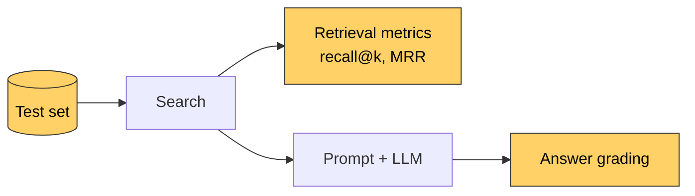

# Lesson 10: Evaluation

[← Lesson 9](lesson09_rag.md) · [Overview](../README.md)

> **You'll learn:** how to build a test set, measure retrieval with recall@k and MRR,
> compare settings fairly, grade generated answers, and where automatic grading fails.
>
> **Run:** `uv run lessons/lesson10_eval.py` (retrieval, about a minute), or
> `uv run lessons/lesson10_eval.py --answers` (also grades the answers, a few minutes more)



## Concept: measure, don't guess

Earlier lessons left several questions open:

- Do the tiny chunks hurt search? *(lessons 2 and 3)*
- Is a smaller chunk size better? *(lesson 2)*
- Does the heading path help? *(lesson 5)*
- Does the query instruction help? *(lesson 7)*
- How much worse is naive chunking, really? *(lesson 2)*

And lesson 9 showed that a single sentence in the prompt can change the answers. Looking
at three or four examples can't settle any of this. You need a **fixed test set** and
**numbers**, so that every change is measured on the same questions.

## The test set

`eval/questions.jsonl` has one question per line, in JSON:

```json
{"question": "Which library draws the moving map?", "source": "architecture.md",
 "snippets": ["**Leaflet** (1.9.4, unpkg) for the moving map"], "answer_keywords": ["Leaflet"]}
{"question": "Who is the mayor of Kestrel Island?", "source": null,
 "snippets": [], "answer_keywords": []}
```

- **`snippets`:** text that the chunk holding the answer must contain. Retrieval counts as
  correct when a result from the right `source` contains one of them. Each snippet was
  checked to appear exactly once in its document, so it identifies one place.
- **`answer_keywords`:** words a correct answer must contain, e.g. `"24"` for the ferry
  price. A rough check for the generated answers.
- **`source: null`:** the documents don't answer the question. The right response is to
  refuse.

The 31 questions:

```
   17 about architecture.md
   10 about kestrel-island.txt
    4 without an answer in the documents
```

The OpenSim questions come from many sections: tables (telemetry rate, fuel), code blocks
(step 5, the rocket time step), bold summaries ("The Earth doesn't rotate.") and
"Observations" paragraphs. Two of the no-answer questions are traps: the island has an
**island council but no mayor**, and the guide gives the **island's** population but not
**Port Alda's**.

A test set should look like the questions real users will ask: different topics, different
phrasings, and some questions the documents can't answer.

## The metrics

For every answerable question, we note the **rank** of the first correct chunk in the
search results (1 = best).

- **Recall@k:** the share of questions whose correct chunk is among the top k. Recall@4
  matters most for us, because lesson 9 puts the top 4 into the prompt.
- **MRR** (mean reciprocal rank): the average of `1 / rank`. 1.0 if the correct chunk is
  always first, 0.5 if always second, 0 if never found. One number for "how high up".

```python
def rank_of(question, results):
    for rank, (_, chunk) in enumerate(results, start=1):
        if chunk.source == question["source"] and any(s in chunk.text for s in question["snippets"]):
            return rank
    return None
```

## 1. Baseline retrieval

The setup from lessons 3–7: structure-aware chunks of up to 400 tokens, heading path,
query instruction.

```
  rank  2  How do I run OpenSim locally?
  rank  1  What happens during step 5 of mission loading?
  ...
  rank  2  Can I pay by card on the ferry?

  R@1 0.74   R@3 1.00   R@5 1.00   MRR 0.87
```

**For all 27 answerable questions, the right chunk is in the top 3**, and for 74% it's
first. Retrieval works well on this test set. When answers go wrong, the problem is more
likely in generation.

## 2. Hubness

How often does the same chunk show up in the top 5? Counted per document, because the
island guide has only 11 chunks and its questions naturally return the same ones:

```
  questions about architecture.md (17):
    in  5 of 17 top-5 lists    ... > 9. Aircraft Systems > 9.1 Overview
    in  3 of 17 top-5 lists   ... > 2.4 The timeline: `atcClearances`
    in  3 of 17 top-5 lists   ... > 6.2 The frame loop (`core/loop.js`)

  questions about kestrel-island.txt (10):
    in  9 of 10 top-5 lists   kestrel-island.txt   ('The lighthouse on Gannet Hea')
    in  7 of 10 top-5 lists   kestrel-island.txt   ('The most important event of ')
    in  6 of 10 top-5 lists   kestrel-island.txt   ('The ferry does not sail when')
```

- **OpenSim:** the strongest hub is the 9.1 table, which lists every aircraft system. In
  lesson 7, with 5 questions, the introduction and the directory tree looked like the big
  hubs. With 17 varied questions, the picture is different. Conclusions from a handful of
  examples don't hold up.
- **The island guide:** one chunk is in the top 5 for 9 of 10 questions. It starts with the
  lighthouse and continues with the ferry timetable: without headings, the chunker packs
  several topics into one chunk, and a chunk about many things is a little similar to
  many questions. Missing structure makes hubs.

## 3. Experiments: one change at a time

```
  setup                                chunks    R@1    R@3    R@5    MRR   md R@3  txt R@3
  baseline                                119   0.74   1.00   1.00   0.87     1.00     1.00
  no query instruction                    119   0.74   1.00   1.00   0.85     1.00     1.00
  no heading path                         119   0.74   0.96   0.96   0.83     0.94     1.00
  smaller chunks (200 tokens)             212   0.81   1.00   1.00   0.90     1.00     1.00
  tiny chunks removed (< 30 tokens)       116   0.74   1.00   1.00   0.87     1.00     1.00
  naive chunks (1200 chars)                93   0.70   0.93   0.93   0.81     0.88     1.00
```

Each row changes exactly one thing compared to the baseline, so differences can be
attributed to that change. Now the open questions have answers:

- **Query instruction** *(lesson 7)*: a small gain (MRR 0.85 → 0.87). Keep it.
- **Heading path** *(lesson 5)*: without it, "Which aircraft uses the kinematic flight
  model?" isn't found at all. Section 7.3's text never says "kinematic"; only its heading
  does: `7.3 The kinematic model`. The heading path carries words the text itself doesn't
  contain.
- **Chunk size** *(lesson 2)*: 200-token chunks rank the right chunk first more often
  (R@1 0.74 → 0.81, MRR 0.87 → 0.90).
- **Tiny chunks** *(lessons 2 and 3)*: removing them changes nothing. They neither help nor
  hurt here, so there's no reason to add code for them. Measuring saved us a fix.
- **Naive chunking** *(lesson 2)*: the worst setup. On `architecture.md`, recall@3 drops to
  0.88: the hydraulics and kinematic-model questions fall to rank 7. On the plain-text
  guide, it makes no difference. That's lesson 2's finding, now in numbers: **structure
  matters for structured documents.**

## 4. Grading the answers

With `--answers`, every question goes through the full RAG pipeline from lesson 9, and the
answer is graded automatically (the run takes a few minutes, because every answerable
question is also asked once without RAG):

- **answerable question:** correct if it contains one of the `answer_keywords`;
- **no-answer question:** correct if it refuses, i.e. contains a phrase like "doesn't say"
  or "not specified".

Wrong answers are also classified using the retrieval rank: if the correct chunk was in
the top 4, it was in the prompt, so it's a **generation** problem; otherwise a
**retrieval** problem (lesson 9's debugging rule, automated).

```
  correct ✓              25
  wrong ✗ (generation)   2
  refused ✓              3
  answered ✗             1
```

The failures:

| Question | Answer | |
|---|---|---|
| Does OpenSim support multiplayer? | "No, OpenSim supports multi-player through its WebSocket hub …" | generation: contradicts itself (lesson 9) |
| Do the airliner hydraulics affect the flight controls? | "Yes, the hydraulics module affects the flight controls …" | generation: the document says they're a display model |
| What is the population of Port Alda? | "Port Alda is a town located approximately ten nautical miles off the mainland harbour town of Port Alda." | a trap question, answered with nonsense instead of a refusal |

Both wrong answers are generation problems: retrieval delivered the right passage.

### Can the model answer without RAG?

A correct answer only proves that retrieval worked if the model couldn't have produced it
anyway. So the script also asks every answerable question **without any context** and grades
that answer the same way:

```
  0 of 27 answerable questions also pass without RAG:
```

None. The model doesn't know OpenSim's internals, and it didn't guess any island facts,
not even the "typical" ones you might expect a model to guess, like "no cars on a small
island" or "no hospital". (The island guide was written with an LLM, so some of its details
could be the kind other models find plausible; see lesson 1.) Every correct answer above
really came from retrieval.

This check is cheap insurance for any test set. A question that passes without RAG doesn't
test retrieval: replace it or mark it. Run the check again when you switch to a bigger or
newer model. It may know more, or guess better, especially if it's the model that wrote
the test documents.

### Where automatic grading fails

One answer was graded **correct** but isn't:

```
Q: Can I pay by card on the ferry?
A: Yes, visitors can pay by card on the ferry, but the ferry desk accepts cash only.
```

It contains the keyword "cash", so it passes, but it starts with the wrong answer and
contradicts itself. The real score is **24 of 27**, not 25. Keyword grading is cheap and
useful for spotting changes, but it can't understand an answer. Read the answers, at least
the ones that changed. Larger systems often use **LLM-as-judge**: a (bigger) language model
compares each answer with the expected one. It's more flexible, but it makes mistakes too.

## What we keep, and a warning

200-token chunks were better in section 3, and the exercise below shows they also give
better answers on this test set. The course still keeps 400 tokens, so that the outputs in
lessons 3–9 stay as they are, but for your own documents, 200 is worth trying.

And a warning: **31 questions is a small test set.** A difference of one question changes
recall by 4 percentage points. The more you tune settings on the same test set, the more
you risk fitting the settings to these particular questions rather than to your users.
Keep adding questions, especially ones that failed in practice.

## Python notes

- **JSON Lines** (`.jsonl`): one JSON object per line; read with
  `[json.loads(line) for line in f if line.strip()]`.
- **`Counter`** (from `collections`) counts things: `Counter(items).most_common(3)`.
- **`@dataclass class Setup:`** with **default values**: `Setup("naive", chunker="naive",
  heading=False)` overrides only what's different.
- **`def recall(k, source=None):` inside `evaluate_retrieval`**: a function defined inside
  another can use its variables (`answerable`), like the closure in lesson 3.
- **`{"ranks": ranks, **{f"R@{k}": recall(k) for k in KS}}`**: a dict comprehension, merged
  into a dict literal with `**`.
- **`"--answers" in sys.argv`**: a simple command-line flag.

## Key takeaways

- A test set with known answers turns opinions into numbers; include questions without an
  answer.
- Change one thing at a time, and compare on the same questions.
- Retrieval metrics (recall@k, MRR) and answer quality are different things; measure both.
- Ask the test questions without RAG too: a question the model can answer on its own
  doesn't test retrieval.
- Automatic grading is a tool, not the truth. Read the answers.

## Exercises

1. Set `MAX_TOKENS = 200` and `OVERLAP_TOKENS = 50` in `lesson03_tokens.py`, then run
   `uv run lessons/lesson10_eval.py --answers`. (The index is rebuilt automatically, because
   the settings are part of the fingerprint.) Are the answers better? Set the values back
   afterwards.
2. Add two questions of your own to `eval/questions.jsonl`, one answerable and one not. Check
   that your snippet appears exactly once in the document.
3. Why does the "kinematic flight model" question fail without the heading path, but still
   reach rank 7 with naive chunks, which have no heading path either?

<details>
<summary>Solution 1</summary>

With 200-token chunks, **all 27 answerable questions pass** the keyword check, including
multiplayer and hydraulics, which failed with 400 tokens. Smaller chunks mean the top 4
contain fewer distracting paragraphs.

But the no-answer questions get worse:

- "What is the population of Port Alda?" → "Port Alda has a population of approximately
  412 people." 412 is the **island's** population: the model attached it to the wrong
  place.
- "Which license does OpenSim use?" → "OpenSim uses no specific licensing information
  provided in the given context." That's a refusal in clumsy words, but none of the
  refusal phrases match, so it's graded as wrong: another grading error.

Better on one kind of question, worse on another. Exactly why a test set needs both kinds.
</details>

<details>
<summary>Solution 2</summary>

Check the snippet in the REPL (in `lessons/`):

```python
from lesson01_load import load_documents
text = {d["source"]: d["text"] for d in load_documents()}["architecture.md"]
text.count("your snippet")   # must be 1
```

A snippet must also be on **one line** of the document: chunks keep the original line
breaks, so a snippet that spans a line break never matches.
</details>

<details>
<summary>Solution 3</summary>

Naive chunks cut through the document regardless of headings, so the heading line
`` ### 7.3 The kinematic model (no `manualControl`) `` ends up **inside** a chunk's text,
in the middle of a chunk that runs from the end of 7.2 (the autopilot) into 7.4. The word "kinematic" is
there, which is why it's found at all, but it's diluted by the other topics, which is why
it only reaches rank 7. Structure-aware chunks remove the heading from the text and keep
it in the heading path, so without the heading path, the word is gone completely.
</details>

---

[← Lesson 9: RAG](lesson09_rag.md) · [Overview](../README.md) · Lesson 11: Reranking *(coming soon)*
